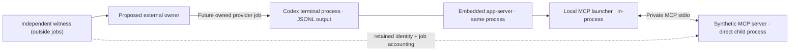
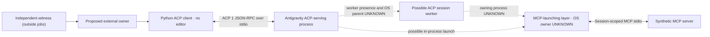
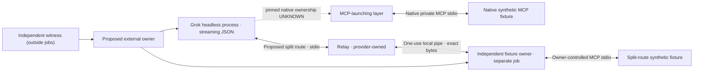

# Stage 1.5 native provider route assessment

This assessment covers the Windows clients identified in the Stage 0 and Stage 1.2 records. The current executable bytes were matched against official artifacts. A restricted version-query harness failed before process creation, so no vendor version or help command ran. The version results are artifact identifications. No provider executable started during this assessment.

| Route | Archived Stage 0 | Stage 1.2 and installed | Exact implementation evidence |
|---|---|---|---|
| Codex CLI | Native CLI 0.166.0 in Stages 0A and 0B. Stage 0A also identified the separate Desktop-bundled 0.171.0-alpha.13.2. | `codex.exe` 0.166.0, Windows x64 SHA-256 match | Official `rust-v0.166.0`, source `6ff1e1ca3b30fc8b914720681fcf5fe62e95f856`. [Release](https://github.com/openai/codex/releases/tag/rust-v0.166.0) |
| Google Antigravity CLI | 1.5.18 in Stage 0B | `agy.exe` 1.5.18, Windows amd64 SHA-512 match from the installer manifest | Exact Windows implementation source and release tag UNKNOWN. Manifest supplies artifact identity. [Official installer source](https://antigravity.google/cli/install.ps1), [Windows manifest](https://antigravity-cli-auto-updater-974169037036.us-central1.run.app/manifests/windows_amd64.json) |
| Grok Build | 1.0.92 stable, build `b06756fd6256` in Stages 0A–0C | `grok.exe` 1.0.92, matching Windows x86-64 release bytes and historical build marker | Exact public source UNKNOWN. Official mirror examined at `2bdd1d6a6369de0e8c68132ea4539e9abd9e14a8`, upstream `SOURCE_REV` differs from the historical build marker. [Windows release binary](https://x.ai/cli/grok-1.0.92-windows-x86_64.exe), [mirror provenance](https://github.com/xai-org/grok-build/blob/2bdd1d6a6369de0e8c68132ea4539e9abd9e14a8/SOURCE_REV) |

The [route matrix](route-matrix.json) records the full binary digests, process layers, launch and termination ownership, job and escape boundaries, retained identity, exit status, stdio and receipt risks. The diagrams distinguish historical routes from proposed observation wiring. Dotted links denote unproved Windows edges or observational access.

## Codex CLI 0.166.0

Stage 1.2 used noninteractive ephemeral execution with JSONL. Its dedicated MCP entry omitted the environment ID. The pinned config defaults to local and the pinned client selects the local launcher. That launcher builds the configured executable plus arguments directly, with no evidence of an intervening shell. The terminal entry embeds an app-server client. Stage 0B's separately invoked app-server control-plane test was a different entry point. During the Stage 1.2 run, the MCP handshake recorded `2025-06-18` despite the discovery opt-in. The effective protocol is the recorded handshake. [Stage 1.2 runner](../../work/benchmarks/stage-1.2/agent_trials.py), [run](../stage-1.2/runs/codex-treatment.json), [pinned config default](https://github.com/openai/codex/blob/6ff1e1ca3b30fc8b914720681fcf5fe62e95f856/codex-rs/config/src/mcp_types.rs#L570-L571), [pinned launcher selection](https://github.com/openai/codex/blob/6ff1e1ca3b30fc8b914720681fcf5fe62e95f856/codex-rs/codex-mcp/src/rmcp_client.rs#L1480-L1505), [embedded client source](https://github.com/openai/codex/blob/6ff1e1ca3b30fc8b914720681fcf5fe62e95f856/codex-rs/exec/src/lib.rs#L1027-L1031).

On Windows, the pinned local launcher attempts suspended creation and assignment to a no-breakaway Job Object. On assignment failure it may respawn without that job and try retaining a process handle. The nested assignment and fallback actually taken in Stage 1.2 are UNKNOWN. The pinned shutdown path calls the terminator before closing the inner transport. A parent, job owner or failing observer can therefore lose the chance to collect an in-band child receipt. An external job and retained root/server handles would expose actual exits only after preflight proves containment and identity. The provider's job handle and direct MCP pipes are private. A relay could observe bytes until the relay itself is killed. A separately owned fixture could demonstrate EOF on its own pipe after relay loss. That would establish a split route. [Windows spawn and fallback](https://github.com/openai/codex/blob/6ff1e1ca3b30fc8b914720681fcf5fe62e95f856/codex-rs/rmcp-client/src/stdio_server_launcher.rs#L482-L555), [shutdown order](https://github.com/openai/codex/blob/6ff1e1ca3b30fc8b914720681fcf5fe62e95f856/codex-rs/rmcp-client/src/stdio_server_launcher.rs#L219-L248).

Rolling docs describe ephemeral execution, inline options and MCP configuration. The version-matched loader supports ignoring user configuration, and a staged scratch home can constrain MCP config. Authentication still uses Codex home and its file auth backend can write. The archived credential reference is unsuitable for preserving ordinary sign-in on a future run. A safe, applicable subscription mechanism remains UNKNOWN. [CLI reference](https://learn.chatgpt.com/docs/cli/reference), [MCP configuration](https://learn.chatgpt.com/docs/extend/mcp?surface=cli), [pinned exec flag](https://github.com/openai/codex/blob/6ff1e1ca3b30fc8b914720681fcf5fe62e95f856/codex-rs/exec/src/cli.rs#L40-L46), [pinned file storage](https://github.com/openai/codex/blob/6ff1e1ca3b30fc8b914720681fcf5fe62e95f856/codex-rs/login/src/auth/storage.rs#L257-L269).

## Google Antigravity CLI 1.5.18

The Stage 1.2 Python benchmark was the external ACP client. It spawned Antigravity's serving process and supplied one stdio MCP registration with the new-session request. It ran neither the terminal UI nor editor integration. ACP 1 and MCP `2026-07-28` are distinct handshakes. The absence of an editor wrapper is known. Actual OS ownership of a separate worker and inner server, job inheritance, and service reuse or breakaway are UNKNOWN. The recorded server application stop and successful ACP root exit do not establish the underlying OS fixture exit or cause of pipe closure. The client did not expose complete MCP result bytes. [Stage 1.2 record](../stage-1.2/runs/antigravity-treatment.json), [ACP session protocol](https://agentclientprotocol.com/protocol/v1/session-setup).

Rolling CLI docs describe an editor-launched ACP subprocess and ordinary account/settings integration. Rolling IDE docs describe optional per-session processes for HTTP MCP supplied by an ACP client. The historical caller supplied a **stdio** server and did not request the process-per-session option. Neither rolling description proves a worker was absent or confined on 1.5.18. A new worker in the observed job increases the identities the witness must retain. A reused worker or a process outside the assigned job leaves the descendant and accounting gates open. An alternate process-per-session route would require its own pinned evidence. [CLI ACP](https://antigravity.google/docs/cli/acp), [IDE ACP](https://antigravity.google/docs/ide/extensions/acp).

A driver can directly record the ACP process exit and root pipe terminal reads. Inner MCP bytes and actor EOF require a separately observed fixture endpoint or byte-transparent proxy. Stage 1.2 used disposable app state and a session-local registration, but the archived runner checked normal settings. Safe supported exclusion of ordinary MCP, policy-preserving state isolation and nonmutating account access on this exact release are UNKNOWN. Per-session registration alone cannot establish them.

## Grok Build 1.0.92

Stage 1.2 ran streaming-JSON headless with MCP `2025-11-25`. It used neither the interactive TUI nor the ACP agent process. Stage 0C did exercise ACP separately. That probe and a native headless single-echo probe both exited 1 from retained Windows handles with no fixture EOF. Each associated Grok root exited 0. A disjoint supervisor with a single-use local named pipe also passed a supervised shutdown in Stage 0C, with independently owned fixture stdin closure, actual EOF and exit 0. The supervised result makes an alternate transport feasible for preparation and preserves the native failures. [Stage 1.2 run](../stage-1.2/runs/grok-treatment.json), [Stage 0B/0C compatibility](../wpai-stage-0b-0c-compatibility.md).

The official public mirror's stdio path illustrates an owned child with kill-on-drop, and it includes shared MCP pooling. The archived build has no verified source correspondence to that mirror. Whether any leader, background worker, shared process, nested job, or detached process participates in the pinned headless route remains UNKNOWN. Rolling docs distinguish interactive mode, headless streaming, and separate ACP entry points. They document scoped MCP imports and namespaced tools. Verify exact-version behavior before relying on the defaults or flags. [Public mirror MCP implementation](https://github.com/xai-org/grok-build/blob/2bdd1d6a6369de0e8c68132ea4539e9abd9e14a8/crates/codegen/xai-grok-mcp/src/servers.rs), [Build overview](https://docs.x.ai/build/overview), [headless scripting](https://docs.x.ai/build/cli/headless-scripting), [MCP servers](https://docs.x.ai/build/features/mcp-servers).

A scratch home and workspace can scope tool configuration and folder trust. The historical auth reference does not demonstrate safe reuse and the frozen Grok control included an out-of-scope lookup. Prove the authorization allowlist and prevent imports, persistent trust and background routes before eligibility. Direct inner pipe outcomes remain unavailable to the current witness. The split route adds a controlled close point and separate server job. The owner must identify whether the provider closed its pipe normally, the relay was externally terminated, or the connection failed.

## Witness boundary and observation classes

| Observation | Codex | Antigravity | Grok |
|---|---|---|---|
| Provider root termination and created identity | Direct with owned launch | Direct for ACP root with driver as a distinct actor | Direct for headless root with owned launch |
| Actual MCP server exit | Independently owned launcher in the split design | Not established for native, until retained child identity and job are proven | Independently owned launcher in the split design |
| Full descendants and job accounting | Not established, including nested assignment versus fallback | Not established, including possible worker reuse or separation | Not established for provider job, separate fixture job measurable in split design |
| Both provider-facing and fixture-facing MCP pipe outcomes | Byte-transparent proxy | Byte-transparent proxy, distinct from directly captured ACP | Byte-transparent proxy, distinct from streaming JSON |
| Actual server input EOF and closure attribution | Independent launcher for split route | Independent fixture read and causal writer close, ownership unproved | Independent launcher, previously feasible for the Stage 0C split probe |
| Observer survival and finalization | Direct, outside the jobs | Direct, outside the jobs | Direct, outside both jobs |

These are feasibility classes. On native routes the current witness has no automatic attach or duplication path for provider-private pipe handles. Its Stage 1.4 witnesses control a local synthetic process tree, model both pipe directions and independently retain identities using PID plus creation time. The witness waits for handles to signal, reads the actual codes, and queries job active/total accounting. Stage 1.4.1 adds scenario-specific event counts, roles, causality and completeness. Its scenarios use fixed roles and expected codes. Applying them directly to provider tokens, exits, logs or receipts would overstate coverage. A future route-specific checker can reuse these acquisition primitives after a synthetic preflight. Both existing schemas are frozen. [Stage 1.4](../stage-1.4/handoff.md), [Stage 1.4.1](../stage-1.4.1/handoff.md), [Windows nested jobs](https://learn.microsoft.com/en-us/windows/win32/procthread/nested-jobs), [process exit codes](https://learn.microsoft.com/en-us/windows/win32/api/processthreadsapi/nf-processthreadsapi-getexitcodeprocess).

Observe each direction at its actual reader and writer. An input read-to-EOF at the server, corroborated by an owned writer-close record, can establish real EOF. A disconnect, broken-pipe result or empty queue without those facts leaves the cause open. Output must be drained to a classified terminal read. Extra inherited writer handles can delay EOF. On the relay route record the provider-facing and server-facing pairs independently, byte preserve framing in both directions and forbid log traffic on protocol stdout. The relay can die before an in-band receipt. Its exit, ACP closure and provider output EOF are distinct from complete MCP shutdown. Keep acquisition and finalization outside the tested jobs and abort on unknown job assignment, handle reuse, extra descendants, unattributed close or missing records.
