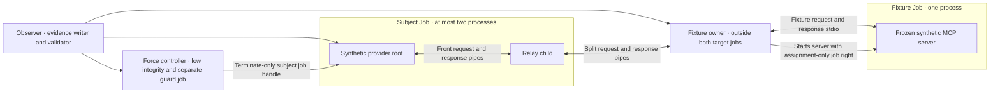

# Split-route process boundaries and witness

The wire protocol is one fixed July MCP `tools/call` operation. The observer checks the frozen package and dataset before launch. The server runs the package's stdio adapter with Stage 1.2's unchanged fictional acquisition, wrapped at the actual pipe reads and writes. The root checks the exact typed twelve-fact report in both result representations. The observer validates the fixed SHA-256 and byte count at six request and six response boundaries. The 248-byte request and 6,953-byte response are forwarded byte for byte. Protocol stdout belongs only to the MCP response pipe. Private actor telemetry uses separate handles.

## Windows handle ownership

| Resource | First created and handed off by | Readers and writers after launch |
|---|---|---|
| Front request and response | Root creates both one-way pipes | Root writes request and reads response. Relay reads request and writes response. |
| Split request and response | Observer creates both anonymous pipes for this run | Relay writes request and reads response. Owner reads request and writes response. Root passes the split handles to the relay and closes its copies. |
| Fixture input | Observer creates one anonymous pipe | Server owns its stdin read end. Owner retains the write end. The duplicate case gives the owner one separate writer copy. The owner-loss case reserves one observer guard copy. |
| Fixture output | Owner creates one anonymous pipe | Server owns stdout write. Owner retains the reader. |
| Control and telemetry | Observer creates fresh private pipes | The observer holds command writers and telemetry readers. Each actor receives only its own complementary ends. Root and owner transfer the relay and server telemetry writers during their child launches and close the launch copies. |
| Standard streams | Launcher gives intentionally listed streams | Synthetic root, relay, owner and force get NUL streams. Server gets fixture stdin/stdout and NUL stderr. |
| Jobs and retained processes | Observer owns query and cleanup handles | Owner gets only fixture assignment authority during server launch. Force gets only subject termination authority. Neither handle is passed to a further child. Retained query/wait handles stay with the observer. |

Explicit Win32 handle lists restrict inheritance. Endpoints are noninheritable except during the corresponding single-threaded launch. Every parent closes its handed-off copies before confirming the child identity. Detached creation prevents Windows from adding a console host to the subject job. The server is assigned while suspended. The relay is created suspended inside the subject job. For both, the observer compares the retained handle against the reported creation identity, checks membership in both jobs, records the exact job members and releases startup explicitly. [Windows process inheritance](https://learn.microsoft.com/en-us/windows/win32/procthread/inheritance) · [Pipe handle inheritance](https://learn.microsoft.com/en-us/windows/win32/ipc/pipe-handle-inheritance).

The force controller is lowered to low integrity before resuming, sits in a one-process guard job and receives only a subject termination handle and its private command and acknowledgement channels. Its deliberate read and append opens against a canary in the protected scratch tree were denied. The scratch tree applies inheritable no-read-up and no-write-up integrity labels. The ledger also holds one exclusive writer with read sharing only. The test exercises the fixed controller's access boundary on the temporary tree. [Windows Mandatory Integrity Control](https://learn.microsoft.com/en-us/windows/win32/secauthz/mandatory-integrity-control) · [SetTokenInformation](https://learn.microsoft.com/en-us/windows/win32/api/securitybaseapi/nf-securitybaseapi-settokeninformation).

## Causal terminal evidence

The actual reader records its terminal `ReadFile` result. Under this Windows anonymous-pipe run, the terminal result was error 109 with no data. The server's input wrapper independently attests the empty read returned to the packaged MCP adapter. That attestation follows explicit last-writer closure. The output terminal read is reported by the owner. Close acknowledgements and command gates establish causes. A forced reader that is already dead is reported as unavailable.

After a forced subject exit, the observer verifies owner and server handles remain active and checks the server still occupies the fixture job. Only then may the owner close the last fixture input writer. With a duplicate writer, the server has entered its next read and remains active with no terminal report throughout the 120 ms observation window. The deliberate last close then permits actual EOF. On owner loss, the observer's guard writer prevents an accidental clean shutdown while it verifies the owner exit and control-channel terminal status. The observer reaps the fixture and subject jobs, closes the guard, and records fixture input and output as unavailable. The timeout regression withholds the request and proves both jobs are empty and outside children stopped before recording unavailability.

## Witness schema `wpai.benchmark.split-route-witness.v1`

Each canonical, newline-terminated JSON row includes `run`, contiguous `seq`, monotonic `ns`, `prev`, `hash`, and `event`. The hash covers every field except itself. The first row binds the scenario and schema to the run. The writer uses exclusive creation, no write sharing, bounded records (96 events, 1,024 bytes per line), and flush plus durable sync for each event. The parser rejects duplicate keys, noncanonical content, invalid hashes and fields, extra events, and broken sequences. A short or truncated record cannot qualify.

The executable schema in `witness.py` binds exact field sets and causal ordering to each scenario. It checks unique opaque process and creation identities, job membership and accounting, retained-handle signals before numeric exits, fixed wire digests, actor-specific closures and terminal reads, scenario survival and observer finalization. Public summaries omit private control frames, protocol content, local paths, raw identities and run timing. The force case qualifies the observation as `observed_failure`, the owner-loss case finalizes `incomplete`, and bounded unexpected timeout is `unavailable`. Integrity failures and inconsistent completed records are `invalid`.

The design covers the fixed Windows synthetic tree and its three pipe segments. Native process trees, platform-specific container policies, provider pipe handles and provider profile isolation remain separate evidence requirements.
