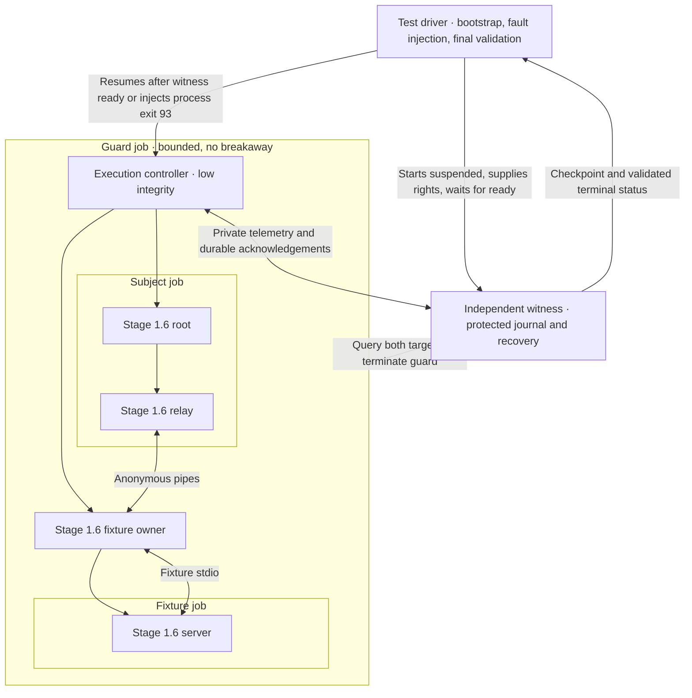

# Independent controller-failure witness

## Process and handle boundaries

The driver creates a fresh scratch directory for every scenario and verifies the frozen Stage 1.2 package and dataset before preparing it. It creates the controller suspended and assigns it to the guard job. It lowers the controller's integrity level before release. The separate witness runs outside the guard and both nested target jobs. It verifies the controller's creation identity, granted process handle access and job memberships before sending readiness. The driver starts the controller only after it receives this readiness. The witness then confirms each actor's retained identity and memberships before acknowledging its startup gate.

| Holder | Authoritative handles |
|---|---|
| Driver | Retained controller and witness process handles and a private witness-status reader. Full-access job bootstrap handles close before either process starts. The driver can terminate the controller to inject the fault. |
| Controller | Subject and fixture handles with exactly `QUERY | ASSIGN_PROCESS`. Stage 1.6 passes a fixture assignment-only duplicate to its fixture owner. The controller's other capabilities are its fixed actor-launch commands and private pipe ends. |
| Witness | Subject and fixture query-only handles, plus a guard handle with exactly `QUERY | TERMINATE`. It retains query-and-wait process handles. It has no job assignment handle. |

The driver duplicates only the intended access masks into explicit inheritance lists. The witness reads the effective granted masks from the owned handles. Stages 1.6 and 1.8 use the same verified Win32 helpers and frozen actors. The guard contains the controller and its descendants, including the fixture owner, with exact subject and fixture jobs nested inside it. This covers descendant launch even if the controller fails before reporting a child's identity. On recovery the witness terminates the guard, then queries each job separately and verifies the active lists and actual process exits where handles were retained. The guard's last handle remains with the witness, which applies kill-on-close without relying on a handle held by the controller. [Job access rights](https://learn.microsoft.com/en-us/windows/win32/procthread/job-object-security-and-access-rights) · [Nested jobs](https://learn.microsoft.com/en-us/windows/win32/procthread/nested-jobs) · [Granted-access inspection](https://learn.microsoft.com/en-us/windows/win32/api/winternl/nf-winternl-ntqueryobject).

The journal directory has a medium-integrity no-read-up and no-write-up label. Its exclusive writer is opened by the witness with read sharing only. Startup exercises the low-integrity controller's write-open denial against both a canary and the real journal. The controller receives no writer handle. Both processes install and exercise the network audit guard before execution. The controller's direct launcher accepts only the fixed Stage 1.6 Python owner and subject entry points. The frozen actors supply the existing child-launch and transport logic. [Windows mandatory integrity control](https://learn.microsoft.com/en-us/windows/win32/secauthz/mandatory-integrity-control).

## Evidence and recovery

The versioned `wpai.benchmark.independent-controller-witness.v1` journal uses the Stage 1.6 bounded canonical serialization, unique run ID, contiguous sequence, monotonic timestamps, SHA-256 chain and durable flush. Stage 1.8 independently binds actor identities, job rights and phases to exact event fields and strict causal order. The witness acknowledges accepted controller telemetry only after its corresponding record is durable. It checks the fixed request and response and uses retained handles to corroborate process signals, exit codes and job accounting. The driver reopens and validates the completed journal after the witness exits.

In a fault case the driver issues real Windows process termination only after the witness verifies the chosen checkpoint. At the in-flight checkpoint, the fixed request crossed the root and relay's first three wire observations. The fixture server remained suspended and its owner waited at the startup gate, holding request delivery before any response. In the final fault case, the complete valid response was observed and normal fixture shutdown had yet to start.

The witness first observes the telemetry pipe's actual terminal ReadFile and the retained controller signal and real exit code. It then observes its own continued liveness, requests guard termination and verifies all three jobs empty within the 8,000 ms recovery window. Controller telemetry closure is distinct from fixture EOF. Every actor terminal observation lost with the controller stays explicitly unavailable. A tested unscripted controller loss also terminates the guard and finalizes as unavailable. A failed observation deadline cannot qualify as success.

The published evidence contains a local Windows reference sample of measured recovery latency, numeric exit codes and ReadFile statuses. Offline replay enforces the same outcome and deadline and compares stable evidence fields. Timing and actor exit codes driven by the race between a pipe failure and guard termination may vary. Reference sample values are preserved during deterministic regeneration, and the manifest binds those exact bytes. Raw process IDs, creation clock values, handles, absolute paths and control packets stay out of publication.

This experiment covers controller-process failure in the fixed synthetic topology. Qualification of native provider routes, machine power loss, kernel failure and arbitrary OS failure remain outside its evidence.
